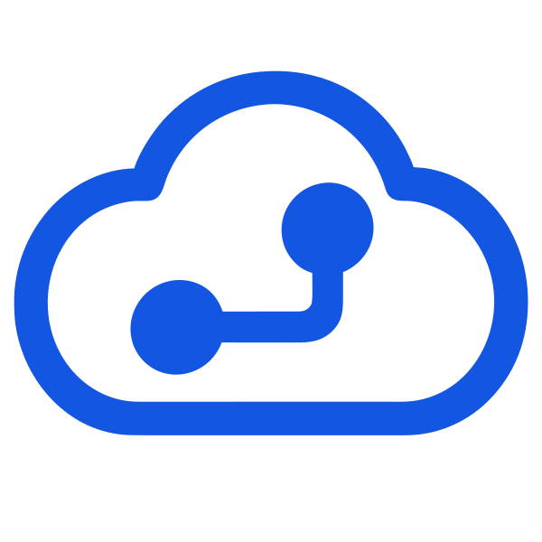
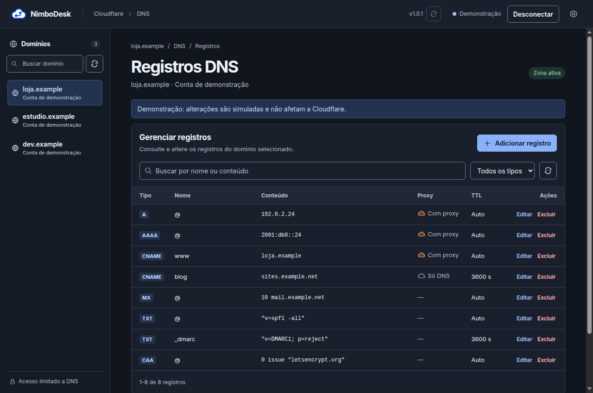
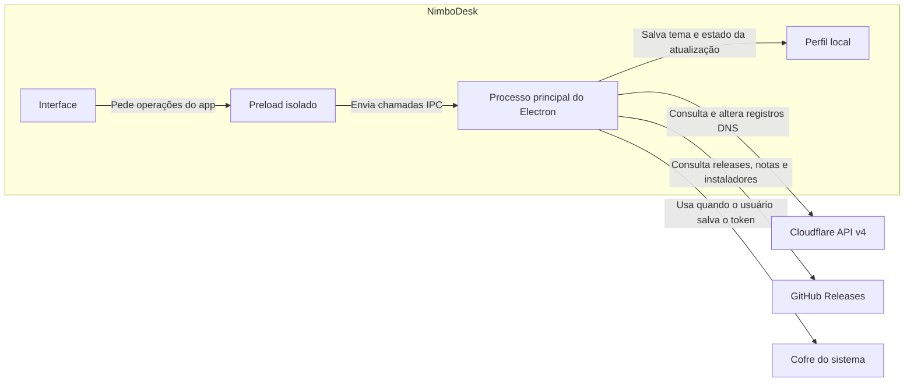

<p align="center">
  
</p>
<h1 align="center">NimboDesk</h1>
<p align="center">
  <strong>Gerencie o DNS da Cloudflare sem abrir o navegador.</strong><br />
  App desktop independente, em português. Windows e Linux, com pacote experimental para macOS.
</p>
<p align="center">
  <a href="https://github.com/kelvinmattosdev/cloudflare-desktop-manager/releases/latest"></a>
</p>
<p align="center">
  <a href="#instalar">Como instalar</a> ·
  <a href="#conectar-à-cloudflare">Configurar o token</a> ·
  <a href="CHANGELOG.md">Changelog</a>
</p>
<p align="center">
  
  
  
</p>



Precisa trocar um IP, apontar um subdomínio ou conferir um TXT? Escolha o domínio na barra lateral, ache o registro e faça a alteração ali mesmo. O NimboDesk cuida dos registros DNS; é um projeto independente, sem vínculo com a Cloudflare.

> A captura mostra a **v1.0.1**, com a nuvem azul, a engrenagem de Configurações e o tema escuro. Essa versão também passa a mostrar as notas depois de atualizar.

| Área | O que dá para fazer |
| --- | --- |
| Domínios | Ver os domínios liberados pelo token, buscar por nome e trocar de domínio sem voltar à tela de conexão. |
| Registros DNS | Buscar por nome ou conteúdo, filtrar por tipo, criar e editar registros. A exclusão pede confirmação. |
| Proxy, TTL e comentários | Ajustar o TTL e anotar para que serve cada registro. O proxy da Cloudflare fica disponível nos tipos que o aceitam. |
| Demonstração | Experimentar a interface com domínios fictícios, sem usar token ou alterar registros na Cloudflare. |
| Aparência · v1.0.1 | Em **Configurações → Aparência**, escolher Sistema, Claro ou Escuro. O app lembra a escolha. |

## Conteúdo

- [Instalar](#instalar) · [Conectar à Cloudflare](#conectar-à-cloudflare) · [Atualizar o app](#atualizar-o-app)
- [Arquitetura](#arquitetura) · [Estrutura do repositório](#estrutura-do-repositório)
- [Dependências e integrações](#dependências-e-integrações) · [APIs](#apis)
- [Rodar a partir do código](#rodar-a-partir-do-código) · [Limites conhecidos](#limites-conhecidos) · [Documentação](#documentação)

## Instalar

Abra a [página de releases](https://github.com/kelvinmattosdev/cloudflare-desktop-manager/releases/latest) e baixe o arquivo do seu sistema.

| Sistema | Arquivo | Como instalar |
| --- | --- | --- |
| Windows 64 bits | `.exe` | Abra o instalador e procure NimboDesk no menu Iniciar. O pacote público não é assinado; o SmartScreen pode exibir um aviso. |
| Zorin OS ou Ubuntu 64 bits | `.deb` | Abra pelo instalador gráfico ou use o comando abaixo. Depois, procure NimboDesk no menu de aplicativos. |
| Linux 64 bits, sem instalar | `.AppImage` | Dê permissão de execução e abra o arquivo. Ele não cria atalho no menu. |
| macOS, Intel e Apple Silicon | `.dmg` universal | Pacote experimental, sem assinatura Developer ID nem notarização. Abra o `.dmg` e arraste o NimboDesk para Aplicativos. O macOS pode bloquear a abertura; instalação e uso ainda não foram testados. |

Para instalar o `.deb` pelo terminal, entre na pasta onde salvou o arquivo. O `./` indica que é um arquivo local, e não um nome para o `apt` procurar nos repositórios:

```sh
sudo apt install ./nimbodesk_1.0.1_amd64.deb
```

Para o AppImage:

```sh
chmod +x nimbodesk_1.0.1_amd64.AppImage
./nimbodesk_1.0.1_amd64.AppImage
```

Use o nome do arquivo que você baixou se for outra versão. Se você instalou a prévia chamada DNS Console, instale o NimboDesk uma vez para passar a receber atualizações pelo endereço novo. No Linux, `dns-console` continua sendo o identificador interno do pacote.

A partir da v1.0.1, na instalação pelo `.deb`, rode `nimbodesk` para abrir o app pelo terminal. No menu, busque por NimboDesk, DNS ou DNS Console. O resultado tem sempre o nome NimboDesk.

## Conectar à Cloudflare

Quer só conhecer o app? Clique em **Abrir demonstração**. Os domínios são fictícios e nenhuma mudança chega à Cloudflare.

1. Na página [API Tokens](https://dash.cloudflare.com/profile/api-tokens/) da Cloudflare, crie um token de usuário com o modelo `Edit zone DNS`.
2. Confira se o token tem `Zone → Zone → Read` e `Zone → DNS → Edit`. Em `Zone Resources`, inclua só os domínios que quer gerenciar.
3. Cole o API Token no NimboDesk. Não use a Global API Key.

Por padrão, o token fica na memória durante a sessão. **Lembrar token** só aparece se o cofre do sistema estiver disponível. Nesse caso, o app guarda uma cópia criptografada no perfil local. Ao clicar em **Desconectar** na sessão da Cloudflare, o NimboDesk apaga essa cópia, mas não revoga o token na Cloudflare.

## Atualizar o app

Ao abrir uma versão instalada, o NimboDesk consulta a última release estável do GitHub. Use o ícone de atualizar no topo para checar de novo. Se houver uma versão nova, clique em **Atualizar para vX.Y.Z**. O app verifica o tamanho e o SHA-256 do arquivo antes de instalar. O GitHub não recebe o token da Cloudflare.

O `.deb` pede aprovação de administrador. O AppImage pode se atualizar sem `sudo` numa pasta onde você tenha permissão de escrita. No Windows, a atualização usa o instalador `.exe`.

Nas atualizações iniciadas pelo app **a partir da v1.0.1**, a janela **O que mudou** aparece ao reabrir. Ela mostra as notas de cada versão incluída, inclusive as que você pulou, e destaca as correções de segurança. Se o GitHub estiver inacessível, o app usa o changelog incluído no pacote. A v1.0.0 não registra a versão de origem, e reinstalar manualmente não abre a janela.

## Arquitetura

O NimboDesk usa Electron, Node.js e uma interface em HTML, CSS e JavaScript. A tela roda isolada, sem acesso direto ao Node.js. O `preload` expõe as operações necessárias; o processo principal valida as chamadas, conversa com a Cloudflare e o GitHub e cuida dos arquivos locais.



O modo demonstração usa um cliente em memória no lugar da Cloudflare. As mudanças feitas ali duram só naquela sessão.

## Estrutura do repositório

| Caminho | Para que serve |
| --- | --- |
| [`src/index.html`](src/index.html), [`src/style.css`](src/style.css) e [`src/ui.js`](src/ui.js) | Telas, temas e interações. |
| [`src/main.cjs`](src/main.cjs) e [`src/preload.cjs`](src/preload.cjs) | Janela Electron e comunicação entre a interface e o processo principal. |
| [`src/api.cjs`](src/api.cjs) e [`src/demo.cjs`](src/demo.cjs) | Cliente da Cloudflare e dados fictícios da demonstração. |
| [`src/updater.cjs`](src/updater.cjs), [`src/native-update.cjs`](src/native-update.cjs) e [`src/release-notes.cjs`](src/release-notes.cjs) | Busca e instalação de atualizações; notas por versão. |
| [`src/theme.cjs`](src/theme.cjs) | Leitura e gravação da preferência de tema. |
| [`test/`](test/) | Testes de lógica e da interface desktop. |
| [`.github/workflows/build.yml`](.github/workflows/build.yml) | Build manual dos instaladores no GitHub Actions, sem criar release. |

## Dependências e integrações

| Serviço | Uso |
| --- | --- |
| Cloudflare API v4 | Lista os domínios autorizados e executa as alterações de DNS. Usa o token fornecido pelo usuário. |
| GitHub Releases | Fornece a versão estável, os arquivos de instalação e as notas de cada versão. A consulta é pública e não usa o token da Cloudflare. |
| Cofre do sistema | Protege o token quando o usuário escolhe salvá-lo. Tema e estado da atualização ficam no perfil local. |

O NimboDesk não tem servidor próprio. O app faz as chamadas direto do seu computador.

## APIs

O processo principal usa `https://api.cloudflare.com/client/v4` com `Authorization: Bearer <API_TOKEN>`. Domínios e registros são consultados com paginação.

| Método e rota | Dados enviados ou retornados |
| --- | --- |
| `GET /zones` | Retorna os domínios autorizados, com identificador, nome e conta. |
| `GET /zones/{zoneId}/dns_records` | Retorna os registros do domínio selecionado. |
| `POST /zones/{zoneId}/dns_records` | Cria um registro. Envia `type`, `name` e `ttl`, além de `content` ou `data` conforme o tipo. Alguns tipos aceitam proxy, prioridade e comentário. |
| `PATCH /zones/{zoneId}/dns_records/{recordId}` | Atualiza o registro selecionado. Na interface, o tipo não muda durante a edição. |
| `DELETE /zones/{zoneId}/dns_records/{recordId}` | Exclui o registro selecionado após confirmação na interface. |

Para atualizar, o app lê `GET /repos/{owner}/{repo}/releases/latest` na API do GitHub. Para montar as notas pós-atualização, lê `GET /repos/{owner}/{repo}/releases` com paginação e seleciona as versões estáveis entre a de origem e a instalada. O repositório usado é `kelvinmattosdev/cloudflare-desktop-manager`.

## Rodar a partir do código

Com Node.js 22 ou mais recente:

```sh
git clone https://github.com/kelvinmattosdev/cloudflare-desktop-manager.git
cd cloudflare-desktop-manager
npm ci
npm start
```

Em outro terminal, na pasta do projeto:

```sh
npm test
npm run test:desktop
```

O teste desktop precisa de um ambiente gráfico. Ele usa um perfil temporário e não precisa de token. Os testes simulam as respostas da Cloudflare e do GitHub.

### Preparar uma release

| Pacote | Comando |
| --- | --- |
| Linux `.deb` e AppImage | `npm run package:linux` |
| Windows `.exe` | `npm run package:win`, no Windows ou no Linux com Wine |
| macOS `.dmg` e `.zip` universal, para teste | `npm run package:mac:unsigned`, num Mac |

Os comandos geram arquivos em `dist/`, sem publicar nada. O workflow [Gerar instaladores](.github/workflows/build.yml) também pode ser executado manualmente.

<details>
<summary>Checklist de publicação e assinatura</summary>

1. Atualize a versão, por exemplo com `npm version patch --no-git-tag-version`. Registre as mudanças no [changelog](CHANGELOG.md).
2. Rode os testes e gere os arquivos da versão. Não misture instaladores e manifestos de builds diferentes.
3. Crie a tag `vX.Y.Z` no commit da versão. Publique como release estável e mais recente, sem renomear os instaladores. Inclua `latest.yml` e o `.blockmap` do Windows com o `.exe`. Quando o pacote macOS estiver assinado e apto a atualizar pelo app, inclua também o `.zip` universal e `latest-mac.yml` com o `.dmg`.
4. Confira os anexos e seus SHA-256 no `GET /releases/latest`. Registre a data no changelog.

No Windows, a assinatura é opcional para o build. No workflow, use os segredos `WINDOWS_CERTIFICATE_BASE64` e `WINDOWS_CERTIFICATE_PASSWORD` para assinar.

Para distribuir no macOS, use um certificado Developer ID Application e notarize o app. No workflow, marque `sign_macos` e configure `MAC_CERTIFICATE_BASE64`, `MAC_CERTIFICATE_PASSWORD`, `APPLE_API_KEY_BASE64`, `APPLE_API_KEY_ID` e `APPLE_API_ISSUER` como segredos. Sem uma cópia com Developer ID instalada fora do `.dmg`, o app encaminha para a página de releases em vez de instalar a atualização.

</details>

## Limites conhecidos

- O app não configura CDN, regras de segurança, DNSSEC ou redirecionamentos da Cloudflare.
- Alguns tipos avançados de registro usam os campos estruturados da API. Para mudar o tipo de um registro, a interface não oferece conversão no lugar.
- A API da Cloudflare limita a listagem de zonas a 500 contas por consulta.
- O macOS ainda não foi validado. O pacote experimental abre a página de releases quando encontra uma versão nova, sem instalar a atualização automaticamente.

## Documentação

- [Histórico de versões](CHANGELOG.md)
- [Releases e arquivos para download](https://github.com/kelvinmattosdev/cloudflare-desktop-manager/releases)
- [Relatar um problema ou sugerir uma melhoria](https://github.com/kelvinmattosdev/cloudflare-desktop-manager/issues)
- Cloudflare: [criar um API Token](https://developers.cloudflare.com/fundamentals/api/get-started/create-token/) e [API de registros DNS](https://developers.cloudflare.com/api/resources/dns/subresources/records/).
